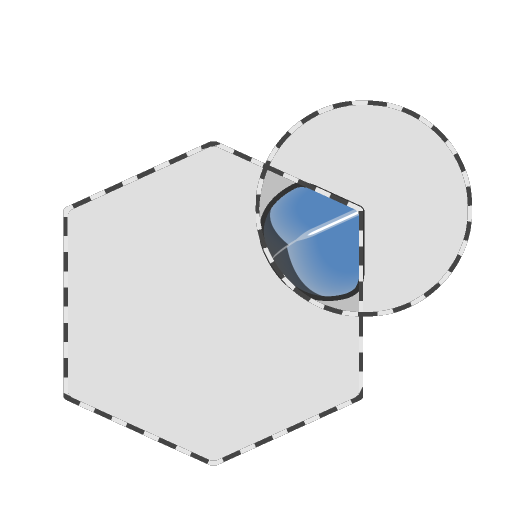

# Lissage de l’intersection

<table>
<tr style="border: 0;">
<td width="33.33%" style="border: 0;" valign="top">

<b>Entrée :</b> Fonction SDF > Opérateur

</td>
<td width="100.00%" style="border: 0;" valign="top">

## Description

Renvoie le volume commun à deux formes SDF, c’est-à-dire le volume créé à l’endroit où deux formes se chevauchent, avec un lissage réglable des bords de leur intersection.

</td>
</tr>
</table>

>[!INFO]
> 
> Pour en savoir plus sur les concepts et les workflows impliquant des Fonctions SDF, consultez la page dédiée : [Utilisation des Fonctions SDF](../../../../../../learning-tutorials/nodes/working-with-sdf-functions/working-with-sdf-functions.md)

## Entrées

|  |  |
| :--- | :--- |
| <b>SDF 1</b> *Flottant* | Première forme SDF. |
| <b>SDF 2</b> *Flottant* | Deuxième forme SDF. |
| <b>Smoothness</b> *Flottant* | Smoothness des arêtes à l&#39;intersection des deux formes SDF.  <i>Remarque :</i> des arêtes dures peuvent apparaître à l&#39;intersection des rayons de lissage.  <i>Par défaut : 0</i> |
