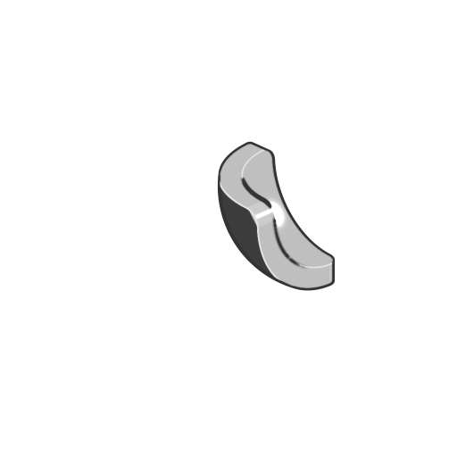

# Surface d&#39;intersection

<table>
<tr style="border: 0;">
<td width="33.33%" style="border: 0;" valign="top">

<b>Entrée :</b> Fonction SDF > Opérateur

</td>
<td width="100.00%" style="border: 0;" valign="top">

## Description

Renvoie la surface de la partie d’une forme SDF de base qui est entrecoupée par une autre forme SDF, avec un thickness réglable.

</td>
</tr>
</table>

>[!INFO]
> 
> Pour en savoir plus sur les concepts et les workflows impliquant des Fonctions SDF, consultez la page dédiée : [Utilisation des Fonctions SDF](../../../../../../learning-tutorials/nodes/working-with-sdf-functions/working-with-sdf-functions.md)

## Entrées

|  |  |
| :--- | :--- |
| <b>SDF de base</b> *Flottant* | Forme SDF sur laquelle est basée la surface obtenue. |
| <b>SDF d&#39;intersection</b> *Flottant* | La forme SDF croise la forme SDF de base. |
| <b>Thickness</b> *Flottant* | Thickness de la surface résultante.  <i>Valeur par défaut : 0.02</i> |
