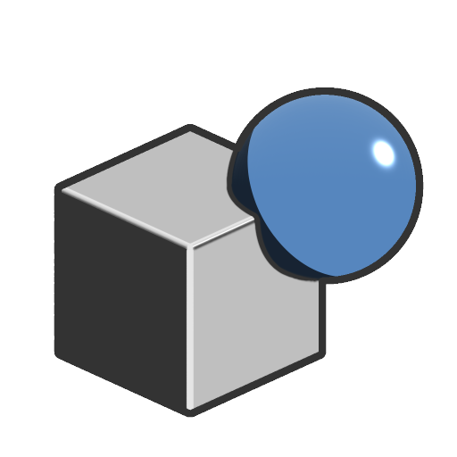

# Union

<table>
<tr style="border: 0;">
<td width="33.33%" style="border: 0;" valign="top">

Icône 

<b>Entrée :</b> Fonction SDF > Opérateur

</td>
<td width="100.00%" style="border: 0;" valign="top">

## Description

Renvoie les volumes ajoutés de deux formes SDF.

</td>
</tr>
</table>

>[!INFO]
> 
> Pour en savoir plus sur les concepts et les workflows impliquant des Fonctions SDF, consultez la page dédiée : [Utilisation des Fonctions SDF](../../../../../../learning-tutorials/nodes/working-with-sdf-functions/working-with-sdf-functions.md)

## Entrées

|  |  |
| :--- | :--- |
| <b>SDF 1</b> *Flottant* | Première forme SDF. |
| <b>SDF 2</b> *Flottant* | Deuxième forme SDF. |
